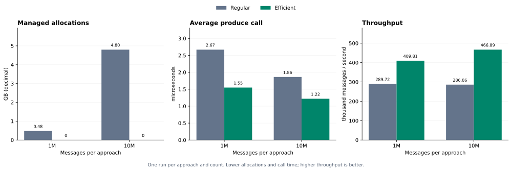

# Confluent Kafka .NET — ZeroAlloc Fork

An experimental fork with zero per-message managed allocations on the successful producer path.

Pass serialized key and value buffers directly to `ProduceEfficient`. We skip per-message serialization and wrapper objects, and use preallocated slots to track delivery reports.

## How to use

Build the producer once, then reuse it and your serialized buffers for each send:

```csharp
using System;
using Confluent.Kafka;

// 1. Prepare serialized key/value bytes. These sample arrays are allocated once.
// In your application, serialize into reusable or pooled buffers.
byte[] keyBuffer = new byte[] { 1, 2, 3 };
byte[] valueBuffer = new byte[] { 4, 5, 6 };
const string topic = "events";

// 2. Configure the producer. The int type is the delivery-report key type;
// the Kafka key and value are passed separately as serialized bytes below.
// Background polling must stay enabled (the default) to process reports.
// The using declaration disposes the producer when this scope ends.
using var producer = new ProducerBuilder<int, byte[]>(new ProducerConfig
{
    BootstrapServers = "localhost:9092"
})
    // 3. Enable efficient-only mode and preallocate 1,024 report slots.
    // This producer must use ProduceEfficient; Produce and ProduceAsync throw.
    // If all slots are occupied, a send waits until a report releases one.
    .SetDeliveryReportEfficient(1024, report =>
    {
        // One handler receives delivery outcomes for all efficient sends.
        // report.Key identifies the send. Use the report only in this callback.
        // Successful reports do no logging here, avoiding logging allocations.
        if (report.ErrorCode != ErrorCode.NoError)
            Console.Error.WriteLine($"Delivery {report.Key} failed: {report.ErrorCode}");
    })
    .Build();

// 4. Send the serialized bytes. The report key is application bookkeeping;
// it does not replace the serialized Kafka key.
producer.ProduceEfficient(
    topic,
    deliveryReportKey: 1,
    keyBytes: keyBuffer.AsMemory(),
    valueBytes: valueBuffer.AsMemory());
// librdkafka has copied the bytes when this call returns: reuse the buffers now.
// Delivery completes later and is reported through the handler above.

// 5. At shutdown, stop new publications and wait for all publishing threads
// to finish. Then drain outstanding deliveries and callbacks before disposal.
producer.Flush();
```

### Important notes

- **Important - shutdown:** the owner must stop accepting new publications, drain its publisher queue, and wait for all threads calling `ProduceEfficient` to finish. Then call `Flush` to complete outstanding deliveries and callbacks before disposing the producer. Keep background polling enabled throughout this drain. `Dispose` does not wait for active produce calls and is not a substitute for draining. If you use `Flush(TimeSpan)`, a nonzero return value means messages or callbacks are still outstanding; handle that before disposal.
- ⚠️ Serialize into reusable buffers before calling `ProduceEfficient`. It accepts nullable `ReadOnlyMemory<byte>` for the key and value; `null` means absent (a null value is a Kafka tombstone), while empty memory means a present zero-length field.
- ⚠️ The producer copies both payloads before the synchronous call returns, so you can reuse the buffers immediately afterward.
- ⚠️ Keep the topic string reusable, and avoid per-message arrays, `ToByteArray()`, or allocating serializers if you want zero per-message managed allocations.
- ⚠️ Efficient delivery reports require background polling (enabled by default). Configure enough slots for the number of in-flight messages; `ProduceEfficient` waits when all slots are occupied. Do not turn off background polling for this mode.
- ⚠️ Reports are callback-scoped. Use their fields inside the callback and do not retain the report or its raw `ErrorReason` span. The callback includes the error code, fatal flag, raw reason, topic, partition, offset, payload length, and the typed report key.
- ⚠️ This path currently uses the default partition and timestamp, and does not support headers. Do not use it with dependent producers created from the same handle.

## Proposed approach

We remove per-message managed work from both sending and delivery reporting, while keeping enough state to report the outcome of each message:

1. **Send serialized buffers directly.** `ProduceEfficient` bypasses the regular message and serializer path. It pins the supplied memory for the native call and uses librdkafka's `MSG_F_COPY` flag. librdkafka copies the bytes before the call returns, so the caller can immediately reuse or return its buffers to a pool.

2. **Reserve a slot before sending.** Building the producer preallocates a fixed-size slot array and a stack of free slot indexes. Each send reserves one slot containing the typed delivery-report key, topic, original value byte length, and an in-use marker. The native message carries `slot index + 1` in its opaque field, linking its eventual delivery report back to this state without allocating a per-message tracking object or `GCHandle`.

3. **Reconstruct the report on success or failure.** The callback reads the native message directly and uses its opaque value to find the slot. The key, topic, and payload length come from the slot, so they remain available even on failure, without relying on the returned payload. `ErrorCode`, partition, and offset come from the native result; `IsFatal` is set when the native code is `Local_Fatal`. Failed reports also carry a UTF-8 error reason. These fields form a callback-scoped `ref struct`. The callback copies the slot's metadata into the report, clears and returns the slot, then invokes the application's handler outside the lock. Successful reports avoid managed allocations; constructing the error reason on failure can allocate.

4. **Apply bounded backpressure.** Reserving and releasing slots share a lock. If no slot is free, the sending thread waits with `Monitor.Wait`, which releases the lock while waiting. Returning a slot calls `Monitor.Pulse` to wake a waiting sender. This bounds tracking storage and outstanding messages awaiting report processing. Background polling must remain enabled so reports can release slots while senders wait. If the native send is rejected synchronously, the call throws a `KafkaException` and returns its slot in `finally`; that rejected send does not wait for a delivery callback.

5. **Drain before shutdown.** The owner must stop and drain publishing threads, then flush outstanding messages and callbacks before disposal. Internally, disposal closes slot admission and wakes all waiting senders, which throw `ObjectDisposedException`. It then stops background polling, destroys the owned native handle, and clears retained slot references. Waking blocked senders does not wait for calls already using the native handle, so the owner must coordinate their completion first.

The result is zero per-message managed allocations for the measured efficient path. Native memory is still allocated: librdkafka manages its own allocations and frees, and the .NET wrapper frees the temporary topic-conversion memory after the native call.

## Benchmarks

The **1M and 10M** results are single runs measured on 28 October 2026. Both paths reuse the same 100-byte key and 100-byte value buffers, with a shared 10,000-message sliding in-flight limit and a 10,000-message warmup before each run.

### Setup

- The benchmark runs on the host machine (Windows, Intel Core Ultra 9 185H, Release/net8.0), with Kafka running locally in Docker on the same machine.
- Kafka uses the test infrastructure in [test/docker/docker-compose-kraft.yaml](test/docker/docker-compose-kraft.yaml): the `apache/kafka:4.0.0` image, with one node acting as both broker and KRaft controller.
- The producer connects to `127.0.0.1:9092` over plaintext; Docker maps this to port 29092 in the container. The `dotnet-benchmark` topic has four partitions and replication factor one, using the [test broker configuration](test/docker/kraft/server.properties).
- Both approaches use background delivery polling and a 5 ms linger. The efficient producer preallocates 10,000 delivery-report slots.

Start the local Kafka infrastructure from the repository root:

```powershell
docker compose -f test/docker/docker-compose-kraft.yaml up -d kafka
```

The producer and broker share the host's resources, so Docker, CPU and disk activity can affect timing and throughput.


| Messages | Approach | Runs | Managed bytes allocated | Mean produce call, µs | Mean throughput, msg/s |
| ---: | :--- | ---: | ---: | ---: | ---: |
| 1,000,000 | Regular | 1 | 480,008,112 | 2.669 | 289,725 |
| 1,000,000 | Efficient | 1 | 0 | 1.549 | 409,807 |
| 10,000,000 | Regular | 1 | 4,800,079,664 | 1.862 | 286,064 |
| 10,000,000 | Efficient | 1 | 0 | 1.219 | 466,885 |



The efficient path allocated **0 managed bytes in both measured runs**. Every run delivered all messages with zero delivery errors.

Throughput is delivered messages divided by elapsed seconds, including sending and waiting for all delivery reports. It is the average rate over the whole run, not a separate one-second test. Setup and warmup are excluded. Average produce-call time is active send-loop duration divided by message count. It excludes explicit capacity waits but includes loop and capacity-check overhead, so it does not measure broker acknowledgement latency. Each path sends continuously from one thread, waiting only when the in-flight limit is reached and draining once after the last send. Capacity waits use the same adaptive SpinWait policy on both paths.
The 100M streaming comparison failed before a complete pair of results was saved and is excluded.
```powershell
.\test\Confluent.Kafka.Benchmark\Xperimental\Efficient\Profile-Allocations.ps1 `
    -Counts 1000000,10000000 `
    -OutputDirectory .\benchmark-results
```

**About the numbers:** allocation figures are exact managed-byte counts from the sending and background delivery threads during the measured interval. They are not object counts, and native allocations are not measured. Timings and the throughput derived from them are approximate: runs use the same machine, broker configuration, inputs, and warmup, but background load, scheduling, GC, and broker/disk state can still differ. Both sizes are single-run observations.

## References

- [Confluent's original .NET Kafka client](https://github.com/confluentinc/confluent-kafka-dotnet) — the upstream project this fork is based on; see its README for general client documentation.
- [G-Research's experimental Kafka .NET work](https://github.com/G-Research/confluent-kafka-dotnet) — inspiration for the allocation-efficient producer approach.

Licensed under [Apache 2.0](LICENSE). Original copyright: 2016–2019 Confluent Inc.; 2015–2016 Andreas Heider.

KAFKA is a registered trademark of The Apache Software Foundation and has been licensed for use by confluent-kafka-dotnet. This project has no affiliation with and is not endorsed by The Apache Software Foundation.
